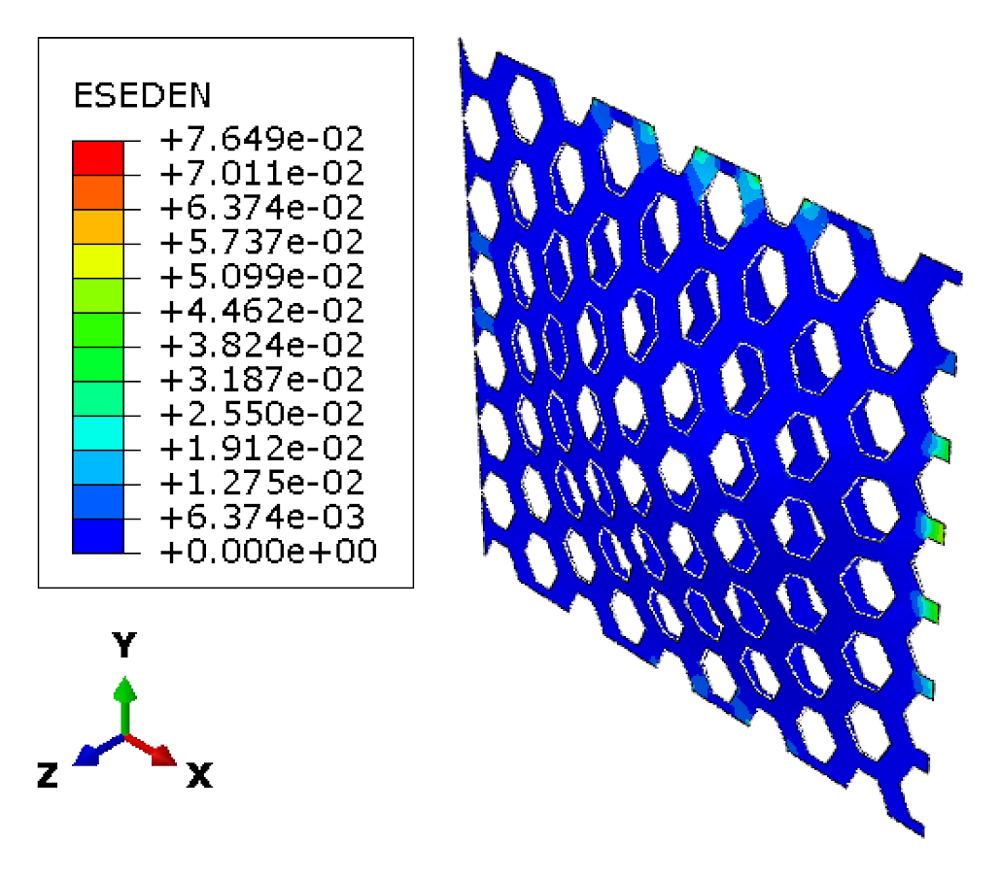
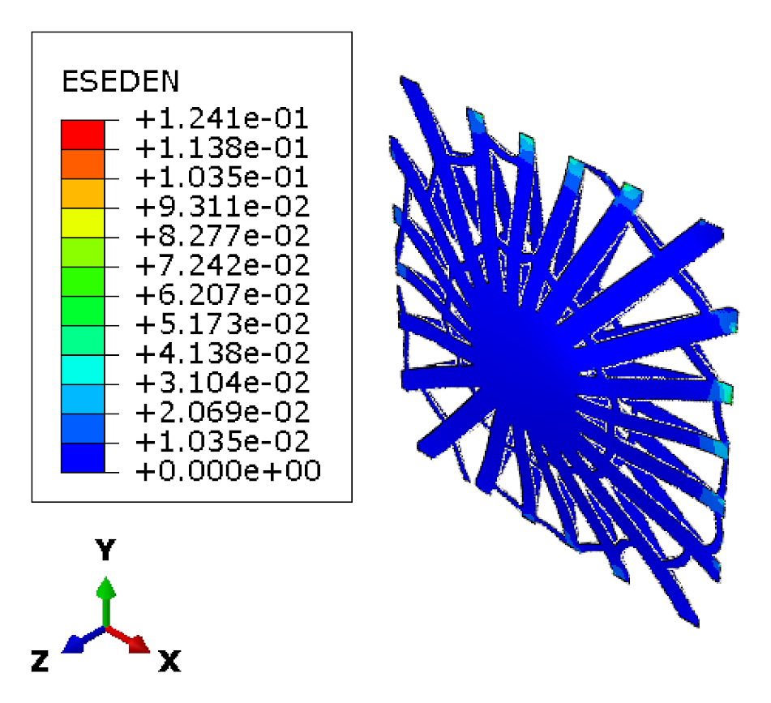
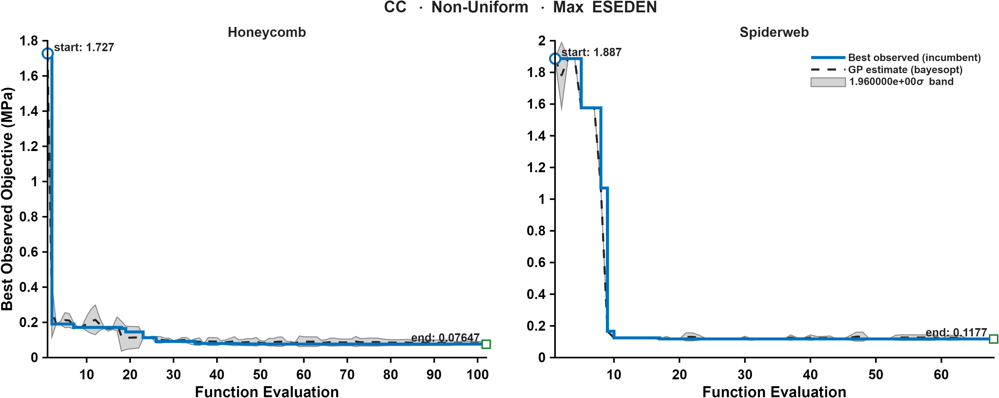

CASE 12 OF 12

# Clamped &middot; Non-Uniform Pressure

### Minimize maximum ESEDEN

[&larr; Case 11](../CC_NonUniform_TotalESEDEN/) &nbsp;&middot;&nbsp; [Case Index](../README.md#case-index) &nbsp;&middot;&nbsp; [Case 01 &rarr;](../SS_Uniform_VM/)

 

| Boundary condition | Loading | Objective |
|:--|:--|:--|
| Clamped, all edges | Non-uniform transverse pressure, <i>P</i>(<i>x</i>,<i>y</i>) &prop; <i>x</i>2 + <i>y</i>2 | Minimize maximum elastic strain energy density (ESEDEN) |

## Optimal Designs

### Honeycomb

<table>
<tr>
<td width="64%" align="center"> Elastic strain energy density, ESEDEN (MPa)</td>
<td width="36%" valign="middle">
<table>
<tr><th>Parameter</th><th>Value</th></tr>
<tr><td align="center">&alpha;</td><td align="right">1.1682</td></tr>
<tr><td align="center">&beta;</td><td align="right">0.13938</td></tr>
<tr><td align="center"><i>t</i></td><td align="right">9 mm</td></tr>
<tr><td align="center"><i>h</i></td><td align="right">35.094 mm</td></tr>
<tr><td align="center">Area fraction</td><td align="right">59.43 %</td></tr>
<tr><td align="center">Shell thickness</td><td align="right">8.41 mm</td></tr>
</table>
</td>
</tr>
</table>

### Spider Web

<table>
<tr>
<td width="64%" align="center"> Elastic strain energy density, ESEDEN (MPa)</td>
<td width="36%" valign="middle">
<table>
<tr><th>Parameter</th><th>Value</th></tr>
<tr><td align="center"><i>N</i>r</td><td align="right">22</td></tr>
<tr><td align="center"><i>N</i>s</td><td align="right">2</td></tr>
<tr><td align="center"><i>t</i>r</td><td align="right">10 mm</td></tr>
<tr><td align="center"><i>t</i>f</td><td align="right">4 mm</td></tr>
<tr><td align="center">&sigma;j</td><td align="right">0.15416</td></tr>
<tr><td align="center"><i>A</i></td><td align="right">7.2527</td></tr>
<tr><td align="center"><i>f</i></td><td align="right">-55.571</td></tr>
<tr><td align="center">&phi;</td><td align="right">56.716</td></tr>
<tr><td align="center"><i>p</i></td><td align="right">0.90885</td></tr>
<tr><td align="center">Area fraction</td><td align="right">59.91 %</td></tr>
<tr><td align="center">Shell thickness</td><td align="right">8.43 mm</td></tr>
</table>
</td>
</tr>
</table>

Parameter definitions: [Design Parameterization](../README.md#design-parameterization)

## Performance Metrics

| Metric | Honeycomb | Spider Web |
|:--|--:|--:|
| Max von Mises stress (MPa) | 290.81 | 362.93 |
| Total ESEDEN (MPa) | 298.62 | 412.82 |
| **Max ESEDEN (MPa)** &nbsp;objective | **0.0765** | 0.1241 |
| Max displacement (mm) | 0.2933 | 0.2915 |

## Optimization Convergence

Left: honeycomb &middot; Right: spider web. Solid line: best observed incumbent objective. Dashed line: Gaussian-process posterior mean. Shaded band: 1.96&sigma; credible interval.

---

[&larr; Case 11](../CC_NonUniform_TotalESEDEN/) &nbsp;&middot;&nbsp; [Case Index](../README.md#case-index) &nbsp;&middot;&nbsp; [Case 01 &rarr;](../SS_Uniform_VM/)

