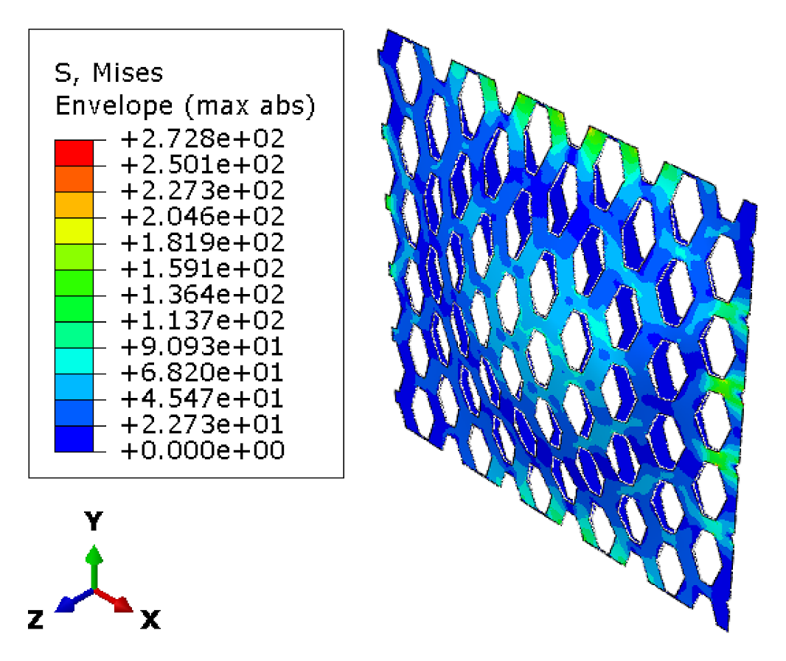
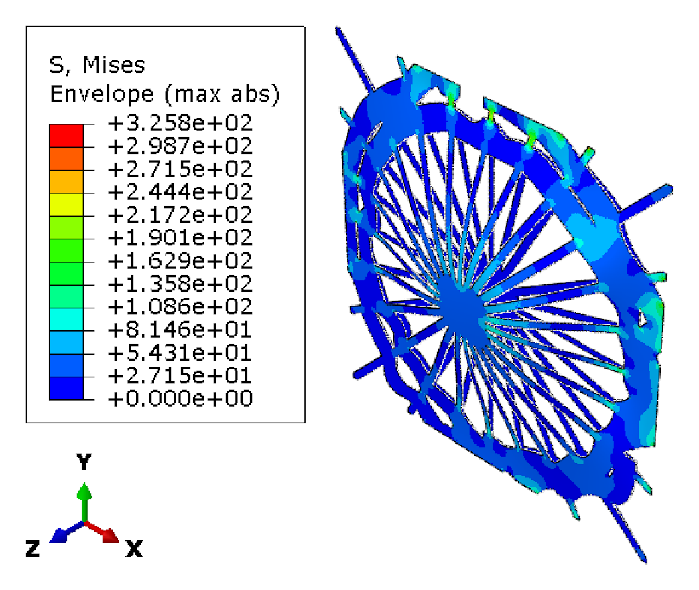
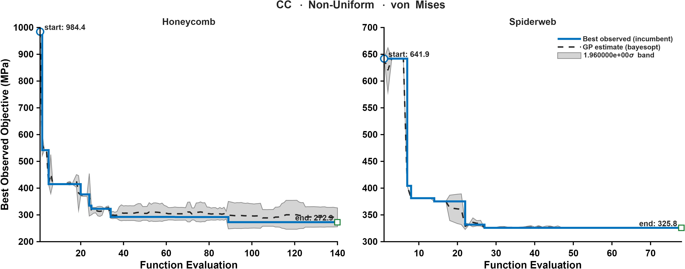

CASE 10 OF 12

# Clamped &middot; Non-Uniform Pressure

### Minimize maximum von Mises stress

[&larr; Case 09](../CC_Uniform_MaxESEDEN/) &nbsp;&middot;&nbsp; [Case Index](../README.md#case-index) &nbsp;&middot;&nbsp; [Case 11 &rarr;](../CC_NonUniform_TotalESEDEN/)

 

| Boundary condition | Loading | Objective |
|:--|:--|:--|
| Clamped, all edges | Non-uniform transverse pressure, <i>P</i>(<i>x</i>,<i>y</i>) &prop; <i>x</i>2 + <i>y</i>2 | Minimize maximum von Mises stress |

## Optimal Designs

### Honeycomb

<table>
<tr>
<td width="64%" align="center"> von Mises stress (MPa)</td>
<td width="36%" valign="middle">
<table>
<tr><th>Parameter</th><th>Value</th></tr>
<tr><td align="center">&alpha;</td><td align="right">1.5759</td></tr>
<tr><td align="center">&beta;</td><td align="right">0.73028</td></tr>
<tr><td align="center"><i>t</i></td><td align="right">9 mm</td></tr>
<tr><td align="center"><i>h</i></td><td align="right">31.281 mm</td></tr>
<tr><td align="center">Area fraction</td><td align="right">59.77 %</td></tr>
<tr><td align="center">Shell thickness</td><td align="right">8.42 mm</td></tr>
</table>
</td>
</tr>
</table>

### Spider Web

<table>
<tr>
<td width="64%" align="center"> von Mises stress (MPa)</td>
<td width="36%" valign="middle">
<table>
<tr><th>Parameter</th><th>Value</th></tr>
<tr><td align="center"><i>N</i>r</td><td align="right">18</td></tr>
<tr><td align="center"><i>N</i>s</td><td align="right">2</td></tr>
<tr><td align="center"><i>t</i>r</td><td align="right">6 mm</td></tr>
<tr><td align="center"><i>t</i>f</td><td align="right">12 mm</td></tr>
<tr><td align="center">&sigma;j</td><td align="right">0.17202</td></tr>
<tr><td align="center"><i>A</i></td><td align="right">7.7598</td></tr>
<tr><td align="center"><i>f</i></td><td align="right">64.030</td></tr>
<tr><td align="center">&phi;</td><td align="right">6.784</td></tr>
<tr><td align="center"><i>p</i></td><td align="right">2.9218</td></tr>
<tr><td align="center">Area fraction</td><td align="right">55.27 %</td></tr>
<tr><td align="center">Shell thickness</td><td align="right">8.21 mm</td></tr>
</table>
</td>
</tr>
</table>

Parameter definitions: [Design Parameterization](../README.md#design-parameterization)

## Performance Metrics

| Metric | Honeycomb | Spider Web |
|:--|--:|--:|
| **Max von Mises stress (MPa)** &nbsp;objective | **272.80** | 325.84 |
| Total ESEDEN (MPa) | 288.68 | 212.55 |
| Max ESEDEN (MPa) | 0.0801 | 0.1011 |
| Max displacement (mm) | 0.2966 | 0.2662 |

## Optimization Convergence

Left: honeycomb &middot; Right: spider web. Solid line: best observed incumbent objective. Dashed line: Gaussian-process posterior mean. Shaded band: 1.96&sigma; credible interval.

---

[&larr; Case 09](../CC_Uniform_MaxESEDEN/) &nbsp;&middot;&nbsp; [Case Index](../README.md#case-index) &nbsp;&middot;&nbsp; [Case 11 &rarr;](../CC_NonUniform_TotalESEDEN/)

