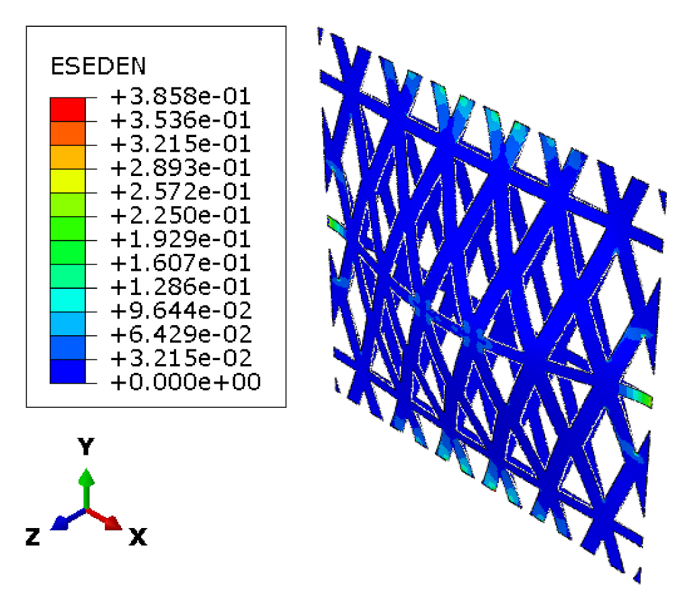
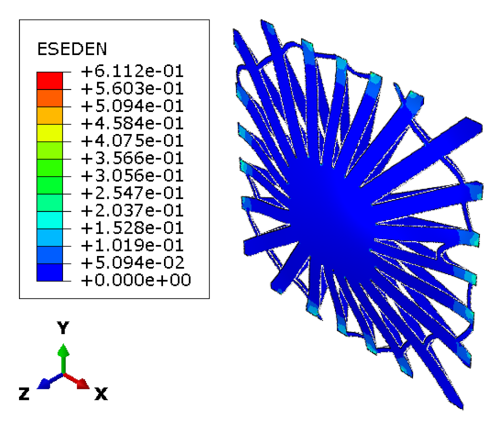
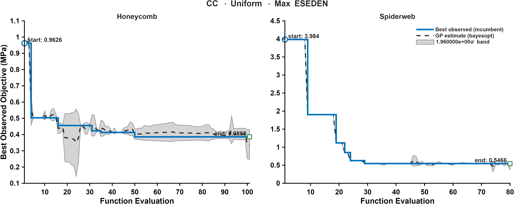

CASE 09 OF 12

# Clamped &middot; Uniform Pressure

### Minimize maximum ESEDEN

[&larr; Case 08](../CC_Uniform_TotalESEDEN/) &nbsp;&middot;&nbsp; [Case Index](../README.md#case-index) &nbsp;&middot;&nbsp; [Case 10 &rarr;](../CC_NonUniform_VM/)

 

| Boundary condition | Loading | Objective |
|:--|:--|:--|
| Clamped, all edges | Uniform transverse pressure | Minimize maximum elastic strain energy density (ESEDEN) |

## Optimal Designs

### Honeycomb

<table>
<tr>
<td width="64%" align="center"> Elastic strain energy density, ESEDEN (MPa)</td>
<td width="36%" valign="middle">
<table>
<tr><th>Parameter</th><th>Value</th></tr>
<tr><td align="center">&alpha;</td><td align="right">0.77307</td></tr>
<tr><td align="center">&beta;</td><td align="right">0.10294</td></tr>
<tr><td align="center"><i>t</i></td><td align="right">8 mm</td></tr>
<tr><td align="center"><i>h</i></td><td align="right">78.251 mm</td></tr>
<tr><td align="center">Area fraction</td><td align="right">57.63 %</td></tr>
<tr><td align="center">Shell thickness</td><td align="right">8.32 mm</td></tr>
</table>
</td>
</tr>
</table>

### Spider Web

<table>
<tr>
<td width="64%" align="center"> Elastic strain energy density, ESEDEN (MPa)</td>
<td width="36%" valign="middle">
<table>
<tr><th>Parameter</th><th>Value</th></tr>
<tr><td align="center"><i>N</i>r</td><td align="right">23</td></tr>
<tr><td align="center"><i>N</i>s</td><td align="right">3</td></tr>
<tr><td align="center"><i>t</i>r</td><td align="right">10 mm</td></tr>
<tr><td align="center"><i>t</i>f</td><td align="right">3 mm</td></tr>
<tr><td align="center">&sigma;j</td><td align="right">-0.13900</td></tr>
<tr><td align="center"><i>A</i></td><td align="right">6.6163</td></tr>
<tr><td align="center"><i>f</i></td><td align="right">17.199</td></tr>
<tr><td align="center">&phi;</td><td align="right">92.25</td></tr>
<tr><td align="center"><i>p</i></td><td align="right">2.7102</td></tr>
<tr><td align="center">Area fraction</td><td align="right">59.75 %</td></tr>
<tr><td align="center">Shell thickness</td><td align="right">8.42 mm</td></tr>
</table>
</td>
</tr>
</table>

Parameter definitions: [Design Parameterization](../README.md#design-parameterization)

## Performance Metrics

| Metric | Honeycomb | Spider Web |
|:--|--:|--:|
| Max von Mises stress (MPa) | 644.38 | 770.46 |
| Total ESEDEN (MPa) | 2244.17 | 3183.36 |
| **Max ESEDEN (MPa)** &nbsp;objective | **0.3858** | 0.6112 |
| Max displacement (mm) | 0.9066 | 0.8306 |

## Optimization Convergence

Left: honeycomb &middot; Right: spider web. Solid line: best observed incumbent objective. Dashed line: Gaussian-process posterior mean. Shaded band: 1.96&sigma; credible interval.

---

[&larr; Case 08](../CC_Uniform_TotalESEDEN/) &nbsp;&middot;&nbsp; [Case Index](../README.md#case-index) &nbsp;&middot;&nbsp; [Case 10 &rarr;](../CC_NonUniform_VM/)

