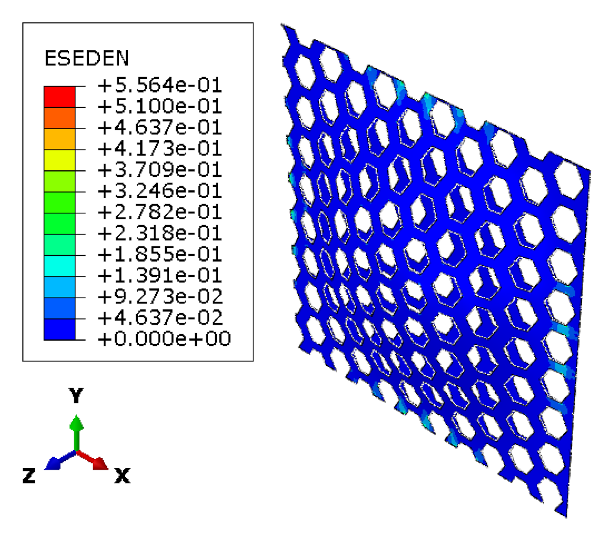
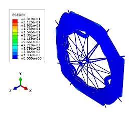
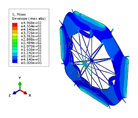
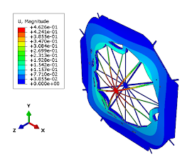
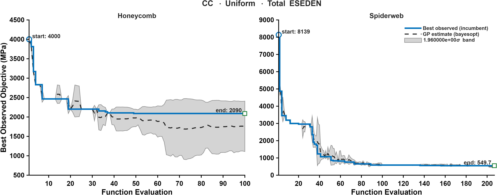

CASE 08 OF 12

# Clamped &middot; Uniform Pressure

### Minimize total ESEDEN

[&larr; Case 07](../CC_Uniform_VM/) &nbsp;&middot;&nbsp; [Case Index](../README.md#case-index) &nbsp;&middot;&nbsp; [Case 09 &rarr;](../CC_Uniform_MaxESEDEN/)

 

| Boundary condition | Loading | Objective |
|:--|:--|:--|
| Clamped, all edges | Uniform transverse pressure | Minimize total elastic strain energy density (ESEDEN) |

## Optimal Designs

### Honeycomb

<table>
<tr>
<td width="64%" align="center"> Elastic strain energy density, ESEDEN (MPa)</td>
<td width="36%" valign="middle">
<table>
<tr><th>Parameter</th><th>Value</th></tr>
<tr><td align="center">&alpha;</td><td align="right">1.0338</td></tr>
<tr><td align="center">&beta;</td><td align="right">0.15278</td></tr>
<tr><td align="center"><i>t</i></td><td align="right">7 mm</td></tr>
<tr><td align="center"><i>h</i></td><td align="right">31.742 mm</td></tr>
<tr><td align="center">Area fraction</td><td align="right">57.05 %</td></tr>
<tr><td align="center">Shell thickness</td><td align="right">8.29 mm</td></tr>
</table>
</td>
</tr>
</table>

### Spider Web

<table>
<tr>
<td width="64%" align="center"> Elastic strain energy density, ESEDEN (MPa)</td>
<td width="36%" valign="middle">
<table>
<tr><th>Parameter</th><th>Value</th></tr>
<tr><td align="center"><i>N</i>r</td><td align="right">12</td></tr>
<tr><td align="center"><i>N</i>s</td><td align="right">23</td></tr>
<tr><td align="center"><i>t</i>r</td><td align="right">2 mm</td></tr>
<tr><td align="center"><i>t</i>f</td><td align="right">7 mm</td></tr>
<tr><td align="center">&sigma;j</td><td align="right">-0.16330</td></tr>
<tr><td align="center"><i>A</i></td><td align="right">1.0835</td></tr>
<tr><td align="center"><i>f</i></td><td align="right">-3.2448</td></tr>
<tr><td align="center">&phi;</td><td align="right">-87.266</td></tr>
<tr><td align="center"><i>p</i></td><td align="right">0.10426</td></tr>
<tr><td align="center">Area fraction</td><td align="right">57.49 %</td></tr>
<tr><td align="center">Shell thickness</td><td align="right">8.32 mm</td></tr>
</table>
</td>
</tr>
</table>

Parameter definitions: [Design Parameterization](../README.md#design-parameterization)

## Performance Metrics

| Metric | Honeycomb | Spider Web |
|:--|--:|--:|
| Max von Mises stress (MPa) | 768.85 | 496.84 |
| **Total ESEDEN (MPa)** &nbsp;objective | 2089.54 | **570.79** |
| Max ESEDEN (MPa) | 0.5564 | 0.2319 |
| Max displacement (mm) | 0.8699 | 0.4626 |

## Optimal Spider Web &middot; Field Outputs

<table>
<tr><th width="33%">ESEDEN (MPa)</th><th width="33%">von Mises stress (MPa)</th><th width="33%">Displacement (mm)</th></tr>
<tr>
<td align="center"></td>
<td align="center"></td>
<td align="center"></td>
</tr>
</table>

## Optimization Convergence

Left: honeycomb &middot; Right: spider web. Solid line: best observed incumbent objective. Dashed line: Gaussian-process posterior mean. Shaded band: 1.96&sigma; credible interval.

---

[&larr; Case 07](../CC_Uniform_VM/) &nbsp;&middot;&nbsp; [Case Index](../README.md#case-index) &nbsp;&middot;&nbsp; [Case 09 &rarr;](../CC_Uniform_MaxESEDEN/)

