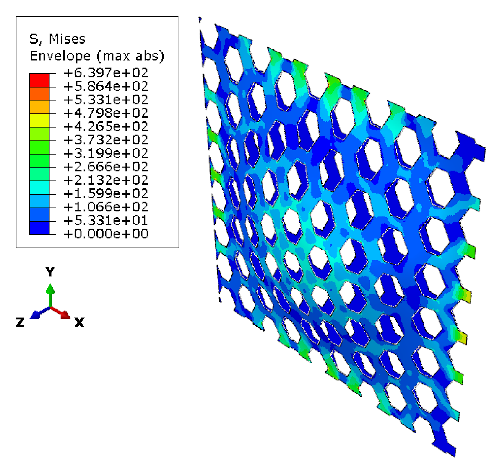
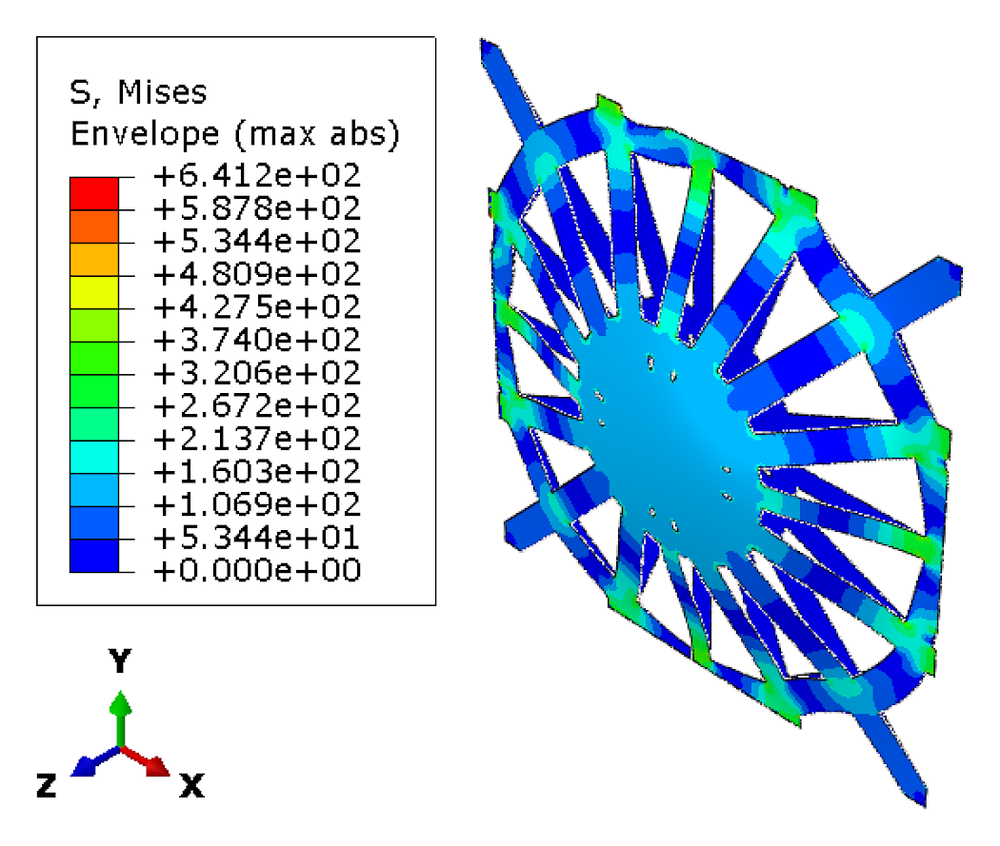
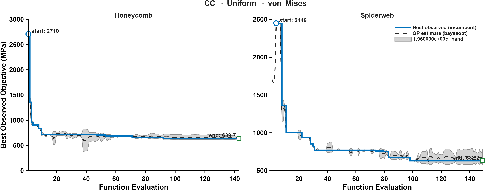

CASE 07 OF 12

# Clamped &middot; Uniform Pressure

### Minimize maximum von Mises stress

[&larr; Case 06](../SS_NonUniform_MaxESEDEN/) &nbsp;&middot;&nbsp; [Case Index](../README.md#case-index) &nbsp;&middot;&nbsp; [Case 08 &rarr;](../CC_Uniform_TotalESEDEN/)

 

| Boundary condition | Loading | Objective |
|:--|:--|:--|
| Clamped, all edges | Uniform transverse pressure | Minimize maximum von Mises stress |

## Optimal Designs

### Honeycomb

<table>
<tr>
<td width="64%" align="center"> von Mises stress (MPa)</td>
<td width="36%" valign="middle">
<table>
<tr><th>Parameter</th><th>Value</th></tr>
<tr><td align="center">&alpha;</td><td align="right">1.1045</td></tr>
<tr><td align="center">&beta;</td><td align="right">0.11402</td></tr>
<tr><td align="center"><i>t</i></td><td align="right">9 mm</td></tr>
<tr><td align="center"><i>h</i></td><td align="right">35.294 mm</td></tr>
<tr><td align="center">Area fraction</td><td align="right">59.89 %</td></tr>
<tr><td align="center">Shell thickness</td><td align="right">8.43 mm</td></tr>
</table>
</td>
</tr>
</table>

### Spider Web

<table>
<tr>
<td width="64%" align="center"> von Mises stress (MPa)</td>
<td width="36%" valign="middle">
<table>
<tr><th>Parameter</th><th>Value</th></tr>
<tr><td align="center"><i>N</i>r</td><td align="right">16</td></tr>
<tr><td align="center"><i>N</i>s</td><td align="right">3</td></tr>
<tr><td align="center"><i>t</i>r</td><td align="right">11 mm</td></tr>
<tr><td align="center"><i>t</i>f</td><td align="right">12 mm</td></tr>
<tr><td align="center">&sigma;j</td><td align="right">0.030589</td></tr>
<tr><td align="center"><i>A</i></td><td align="right">0.20727</td></tr>
<tr><td align="center"><i>f</i></td><td align="right">71.758</td></tr>
<tr><td align="center">&phi;</td><td align="right">10.992</td></tr>
<tr><td align="center"><i>p</i></td><td align="right">2.4755</td></tr>
<tr><td align="center">Area fraction</td><td align="right">59.85 %</td></tr>
<tr><td align="center">Shell thickness</td><td align="right">8.43 mm</td></tr>
</table>
</td>
</tr>
</table>

Parameter definitions: [Design Parameterization](../README.md#design-parameterization)

## Performance Metrics

| Metric | Honeycomb | Spider Web |
|:--|--:|--:|
| **Max von Mises stress (MPa)** &nbsp;objective | 639.72 | 641.23 |
| Total ESEDEN (MPa) | 2062.67 | 2437.37 |
| Max ESEDEN (MPa) | 0.3890 | 0.4123 |
| Max displacement (mm) | 0.7876 | 0.7189 |

## Optimization Convergence

Left: honeycomb &middot; Right: spider web. Solid line: best observed incumbent objective. Dashed line: Gaussian-process posterior mean. Shaded band: 1.96&sigma; credible interval.

---

[&larr; Case 06](../SS_NonUniform_MaxESEDEN/) &nbsp;&middot;&nbsp; [Case Index](../README.md#case-index) &nbsp;&middot;&nbsp; [Case 08 &rarr;](../CC_Uniform_TotalESEDEN/)

