<div align="center">

# Stochastic Spider Webs

### Bio-inspired Metamaterials Design and Structural Optimization

**Mohamed Elleithy** &nbsp;&middot;&nbsp; **Pınar Acar**<br>
<sub>ASTRO Lab &middot; Virginia Tech</sub>

[](#citation)&nbsp;[](#case-index)&nbsp;[](#problem-definition)&nbsp;[](SSW_DO_SuppFile.pdf)


[Problem Definition](#problem-definition) &nbsp;&middot;&nbsp; [Design Parameterization](#design-parameterization) &nbsp;&middot;&nbsp; [Case Index](#case-index) &nbsp;&middot;&nbsp; [Results Summary](#results-summary) &nbsp;&middot;&nbsp; [Repository Structure](#repository-structure) &nbsp;&middot;&nbsp; [Citation](#citation)

</div>

<br>

This repository contains the optimization results for stochastic spider web and honeycomb metamaterial plates: optimal design parameters, performance metrics, finite element field contours, and Bayesian optimization convergence histories for twelve cases spanning two boundary conditions, two pressure distributions, and three structural objectives.

## Problem Definition

<table>
<tr><td width="24%"><b>Domain</b></td><td>Square plate, 250 mm &times; 250 mm</td></tr>
<tr><td width="24%"><b>Architectures</b></td><td>Honeycomb (conventional and re-entrant) &middot; Stochastic spider web</td></tr>
<tr><td width="24%"><b>Boundary conditions</b></td><td>Simply supported (SS), all edges &middot; Clamped (CC), all edges</td></tr>
<tr><td width="24%"><b>Loading</b></td><td>Uniform transverse pressure &middot; Non-uniform transverse pressure, <i>P</i>(<i>x</i>,<i>y</i>) &prop; <i>x</i><sup>2</sup> + <i>y</i><sup>2</sup></td></tr>
<tr><td width="24%"><b>Objectives</b></td><td>Minimize maximum von Mises stress &middot; Minimize total ESEDEN &middot; Minimize maximum ESEDEN</td></tr>
<tr><td width="24%"><b>Optimizer</b></td><td>Bayesian optimization with a Gaussian-process surrogate</td></tr>
<tr><td width="24%"><b>Solver</b></td><td>Finite element analysis (Abaqus)</td></tr>
</table>

<sub>ESEDEN: elastic strain energy density.</sub>

## Design Parameterization

<table>
<tr><th colspan="2" width="50%">Honeycomb</th><th colspan="2" width="50%">Spider Web</th></tr>
<tr><td align="center">&alpha;</td><td>Cell stretch factor; &alpha; &lt; 1 re-entrant, &alpha; &ge; 1 conventional or vertically stretched</td><td align="center"><i>N</i><sub>r</sub></td><td>Number of radial lines</td></tr>
<tr><td align="center">&beta;</td><td>Re-entrant vertical segment ratio, <i>s</i> = &beta;<i>h</i></td><td align="center"><i>N</i><sub>s</sub></td><td>Number of spiral layers</td></tr>
<tr><td align="center"><i>t</i></td><td>Ligament thickness</td><td align="center"><i>t</i><sub>r</sub></td><td>Radial strand thickness</td></tr>
<tr><td align="center"><i>h</i></td><td>Cell length scale</td><td align="center"><i>t</i><sub>f</sub></td><td>Spiral fibril thickness</td></tr>
<tr><td align="center"></td><td></td><td align="center">&sigma;<sub>j</sub></td><td>Randomness factor perturbing the spiral geometry</td></tr>
<tr><td align="center"></td><td></td><td align="center"><i>A</i></td><td>Spiral undulation amplitude</td></tr>
<tr><td align="center"></td><td></td><td align="center"><i>f</i></td><td>Spiral undulation angular frequency</td></tr>
<tr><td align="center"></td><td></td><td align="center">&phi;</td><td>Spiral undulation phase</td></tr>
<tr><td align="center"></td><td></td><td align="center"><i>p</i></td><td>Radial exponent of spiral spacing, <i>r</i><sub>k</sub> = <i>R</i><sub>max</sub>(<i>k</i>/<i>N</i><sub>s</sub>)<sup><i>p</i></sup></td></tr>
</table>

<sub>Area fraction: percentage of the plate area occupied by solid material. Spiral undulation: <i>r&#771;</i><sub>i,k</sub> = <i>r</i><sub>k</sub> + <i>A</i> sin(<i>f</i>&theta;<sub>i</sub> + &phi;).</sub>

## Case Index

<sub>Each cell shows the optimal honeycomb (left) and spider web (right). Select a case to open its results.</sub>

<table>
<tr><th></th><th width="30%">Max von Mises Stress</th><th width="30%">Total ESEDEN</th><th width="30%">Max ESEDEN</th></tr>
<tr><th align="left">SS<br><sub>Uniform</sub></th>
<td align="center"><a href="SS_Uniform_VM/">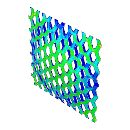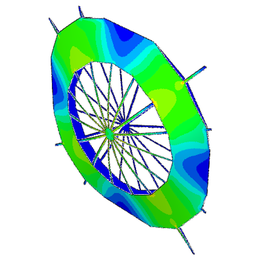</a><br><a href="SS_Uniform_VM/"><b>Case 01</b></a></td>
<td align="center"><a href="SS_Uniform_TotalESEDEN/">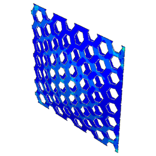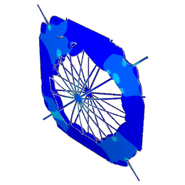</a><br><a href="SS_Uniform_TotalESEDEN/"><b>Case 02</b></a></td>
<td align="center"><a href="SS_Uniform_MaxESEDEN/">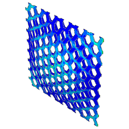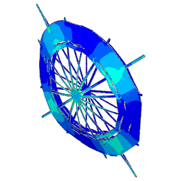</a><br><a href="SS_Uniform_MaxESEDEN/"><b>Case 03</b></a></td>
</tr>
<tr><th align="left">SS<br><sub>Non&#8209;Uniform</sub></th>
<td align="center"><a href="SS_NonUniform_VM/">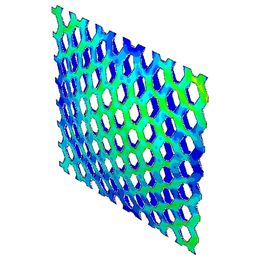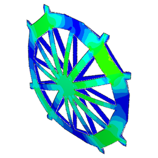</a><br><a href="SS_NonUniform_VM/"><b>Case 04</b></a></td>
<td align="center"><a href="SS_NonUniform_TotalESEDEN/">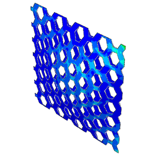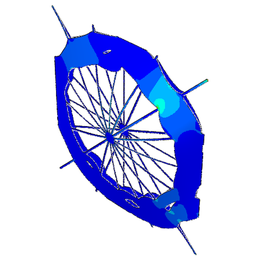</a><br><a href="SS_NonUniform_TotalESEDEN/"><b>Case 05</b></a></td>
<td align="center"><a href="SS_NonUniform_MaxESEDEN/">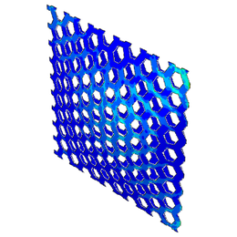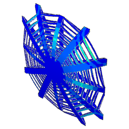</a><br><a href="SS_NonUniform_MaxESEDEN/"><b>Case 06</b></a></td>
</tr>
<tr><th align="left">CC<br><sub>Uniform</sub></th>
<td align="center"><a href="CC_Uniform_VM/">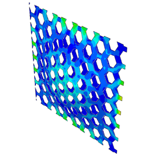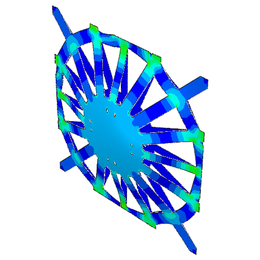</a><br><a href="CC_Uniform_VM/"><b>Case 07</b></a></td>
<td align="center"><a href="CC_Uniform_TotalESEDEN/">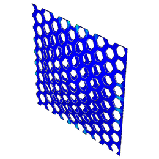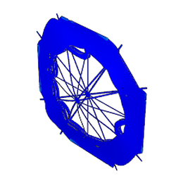</a><br><a href="CC_Uniform_TotalESEDEN/"><b>Case 08</b></a></td>
<td align="center"><a href="CC_Uniform_MaxESEDEN/">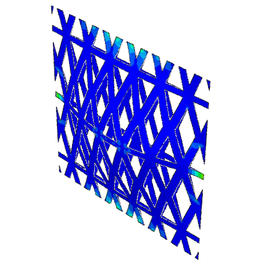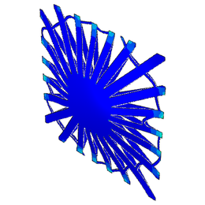</a><br><a href="CC_Uniform_MaxESEDEN/"><b>Case 09</b></a></td>
</tr>
<tr><th align="left">CC<br><sub>Non&#8209;Uniform</sub></th>
<td align="center"><a href="CC_NonUniform_VM/">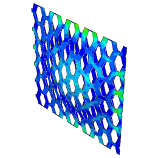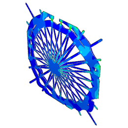</a><br><a href="CC_NonUniform_VM/"><b>Case 10</b></a></td>
<td align="center"><a href="CC_NonUniform_TotalESEDEN/">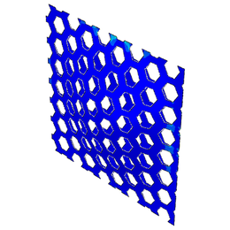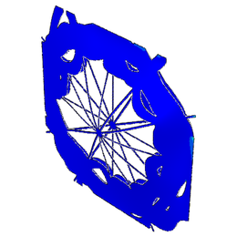</a><br><a href="CC_NonUniform_TotalESEDEN/"><b>Case 11</b></a></td>
<td align="center"><a href="CC_NonUniform_MaxESEDEN/">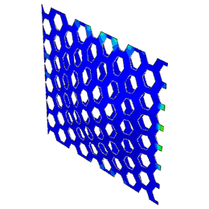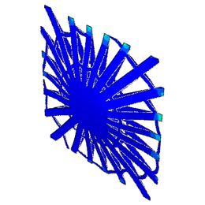</a><br><a href="CC_NonUniform_MaxESEDEN/"><b>Case 12</b></a></td>
</tr>
</table>

## Results Summary

| Case | BC | Loading | Objective | Honeycomb (MPa) | Spider Web (MPa) | Lower objective | &Delta; |
|:-:|:-:|:--|:--|--:|--:|:--|--:|
| [**01**](SS_Uniform_VM/) | SS | Uniform | Max von&nbsp;Mises stress | 749.3 | 542.6 | Spider web | 28% |
| [**02**](SS_Uniform_TotalESEDEN/) | SS | Uniform | Total ESEDEN | 8677 | 5224 | Spider web | 40% |
| [**03**](SS_Uniform_MaxESEDEN/) | SS | Uniform | Max ESEDEN | 0.578 | 0.374 | Spider web | 35% |
| [**04**](SS_NonUniform_VM/) | SS | Non&#8209;uniform | Max von&nbsp;Mises stress | 350.6 | 364.1 | Honeycomb | 4% |
| [**05**](SS_NonUniform_TotalESEDEN/) | SS | Non&#8209;uniform | Total ESEDEN | 1325 | 1034 | Spider web | 22% |
| [**06**](SS_NonUniform_MaxESEDEN/) | SS | Non&#8209;uniform | Max ESEDEN | 0.1183 | 0.1868 | Honeycomb | 37% |
| [**07**](CC_Uniform_VM/) | CC | Uniform | Max von&nbsp;Mises stress | 639.7 | 641.2 | Equivalent | 0.2% |
| [**08**](CC_Uniform_TotalESEDEN/) | CC | Uniform | Total ESEDEN | 2090 | 570.8 | Spider web | 73% |
| [**09**](CC_Uniform_MaxESEDEN/) | CC | Uniform | Max ESEDEN | 0.3858 | 0.6112 | Honeycomb | 37% |
| [**10**](CC_NonUniform_VM/) | CC | Non&#8209;uniform | Max von&nbsp;Mises stress | 272.8 | 325.8 | Honeycomb | 16% |
| [**11**](CC_NonUniform_TotalESEDEN/) | CC | Non&#8209;uniform | Total ESEDEN | 269.9 | 115.3 | Spider web | 57% |
| [**12**](CC_NonUniform_MaxESEDEN/) | CC | Non&#8209;uniform | Max ESEDEN | 0.0765 | 0.1241 | Honeycomb | 38% |

<sub>BC: boundary condition. &Delta;: difference between the two objective values relative to the higher value.</sub>

## Repository Structure

```
.
├── README.md
├── SpiderwebAnimation.gif          Parametric construction of the stochastic spider web
├── SSW_DO_SuppFile.pdf             Complete results for all twelve cases
├── CITATION.cff
├── CC_NonUniform_MaxESEDEN/
├── CC_NonUniform_TotalESEDEN/
├── CC_NonUniform_VM/
├── CC_Uniform_MaxESEDEN/
├── CC_Uniform_TotalESEDEN/
├── CC_Uniform_VM/
├── SS_NonUniform_MaxESEDEN/
├── SS_NonUniform_TotalESEDEN/
├── SS_NonUniform_VM/
├── SS_Uniform_MaxESEDEN/
├── SS_Uniform_TotalESEDEN/
├── SS_Uniform_VM/
├── figures_UQ/                     Convergence histories with uncertainty bands
└── assets/                         Display images and gallery thumbnails
```

Each case folder contains:

| File | Content |
|:--|:--|
| `README.md` | Case definition, optimal designs, design parameters, performance metrics |
| `H_Opt.png` | Optimal honeycomb, objective field contour |
| `SW_Opt.png` | Optimal spider web, objective field contour |
| `H_Optlog.png`, `SW_Optlog.png` | Bayesian optimization histories |
| `SW*_*.png` | Additional spider web field outputs, where available |

## Citation

```bibtex
@article{elleithy2026stochastic,
  author  = {Elleithy, Mohamed and Acar, P{\i}nar},
  title   = {Stochastic Spider Webs: Bio-inspired Metamaterials Design and Structural Optimization},
  journal = {Smart Materials and Structures},
  year    = {2026}
}
```

## Acknowledgment

This work was supported by the National Science Foundation CAREER award CMMI-2236947.

## Contact

Mohamed Elleithy &middot; [melleithy@vt.edu](mailto:melleithy@vt.edu) &nbsp;&nbsp;|&nbsp;&nbsp; Pınar Acar &middot; [pacar@vt.edu](mailto:pacar@vt.edu)
