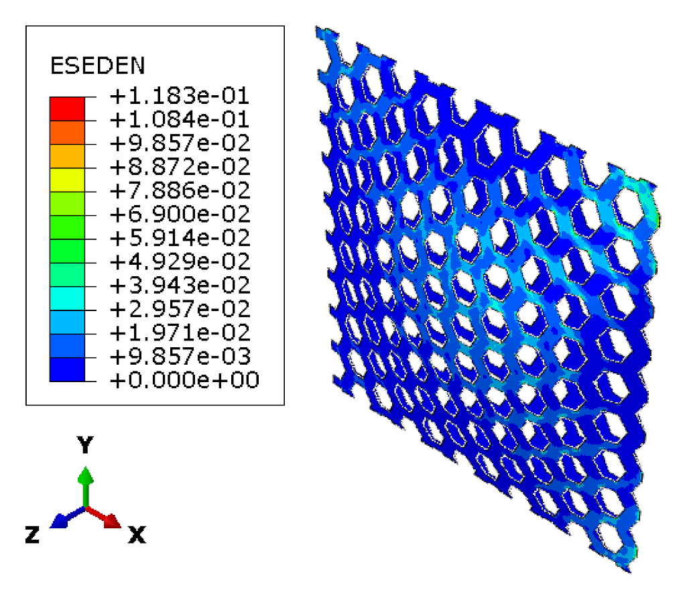
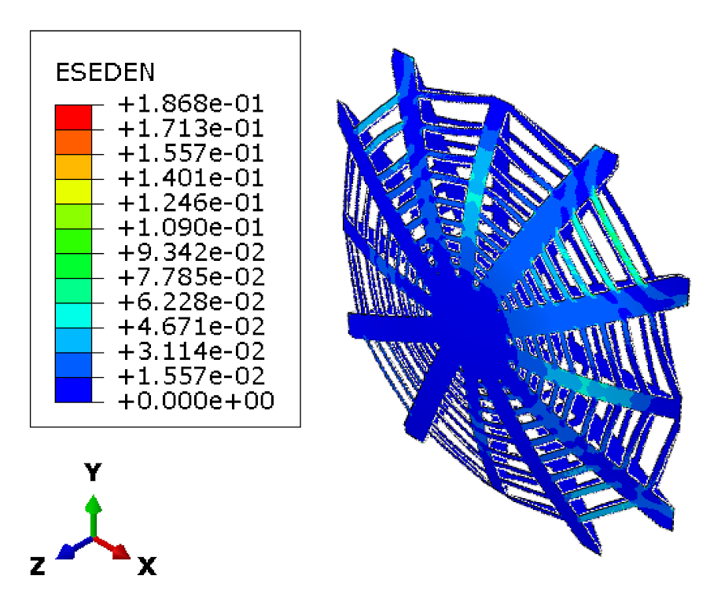
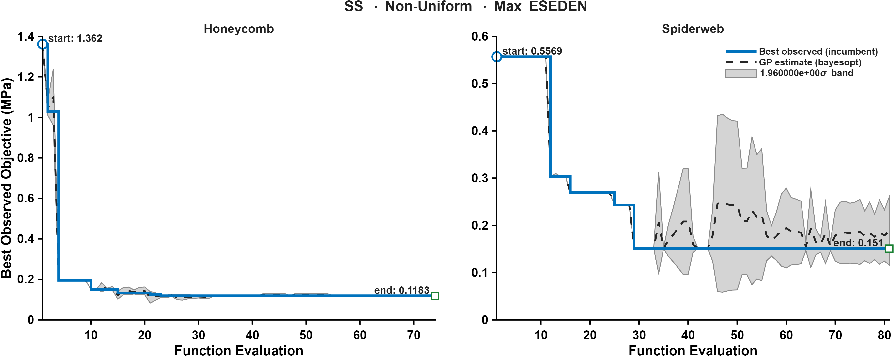

CASE 06 OF 12

# Simply Supported &middot; Non-Uniform Pressure

### Minimize maximum ESEDEN

[&larr; Case 05](../SS_NonUniform_TotalESEDEN/) &nbsp;&middot;&nbsp; [Case Index](../README.md#case-index) &nbsp;&middot;&nbsp; [Case 07 &rarr;](../CC_Uniform_VM/)

 

| Boundary condition | Loading | Objective |
|:--|:--|:--|
| Simply supported, all edges | Non-uniform transverse pressure, <i>P</i>(<i>x</i>,<i>y</i>) &prop; <i>x</i>2 + <i>y</i>2 | Minimize maximum elastic strain energy density (ESEDEN) |

## Optimal Designs

### Honeycomb

<table>
<tr>
<td width="64%" align="center"> Elastic strain energy density, ESEDEN (MPa)</td>
<td width="36%" valign="middle">
<table>
<tr><th>Parameter</th><th>Value</th></tr>
<tr><td align="center">&alpha;</td><td align="right">1.0139</td></tr>
<tr><td align="center">&beta;</td><td align="right">0.22209</td></tr>
<tr><td align="center"><i>t</i></td><td align="right">7 mm</td></tr>
<tr><td align="center"><i>h</i></td><td align="right">30.374 mm</td></tr>
<tr><td align="center">Area fraction</td><td align="right">58.91 %</td></tr>
<tr><td align="center">Shell thickness</td><td align="right">8.38 mm</td></tr>
</table>
</td>
</tr>
</table>

### Spider Web

<table>
<tr>
<td width="64%" align="center"> Elastic strain energy density, ESEDEN (MPa)</td>
<td width="36%" valign="middle">
<table>
<tr><th>Parameter</th><th>Value</th></tr>
<tr><td align="center"><i>N</i>r</td><td align="right">12</td></tr>
<tr><td align="center"><i>N</i>s</td><td align="right">23</td></tr>
<tr><td align="center"><i>t</i>r</td><td align="right">12 mm</td></tr>
<tr><td align="center"><i>t</i>f</td><td align="right">3 mm</td></tr>
<tr><td align="center">&sigma;j</td><td align="right">0.022263</td></tr>
<tr><td align="center"><i>A</i></td><td align="right">4.0188</td></tr>
<tr><td align="center"><i>f</i></td><td align="right">-17.492</td></tr>
<tr><td align="center">&phi;</td><td align="right">96.485</td></tr>
<tr><td align="center"><i>p</i></td><td align="right">2.8646</td></tr>
<tr><td align="center">Area fraction</td><td align="right">54.89 %</td></tr>
<tr><td align="center">Shell thickness</td><td align="right">8.19 mm</td></tr>
</table>
</td>
</tr>
</table>

Parameter definitions: [Design Parameterization](../README.md#design-parameterization)

## Performance Metrics

| Metric | Honeycomb | Spider Web |
|:--|--:|--:|
| Max von Mises stress (MPa) | 403.63 | 433.48 |
| Total ESEDEN (MPa) | 1367.19 | 1908.52 |
| **Max ESEDEN (MPa)** &nbsp;objective | **0.1183** | 0.1868 |
| Max displacement (mm) | 1.0272 | 1.0971 |

## Optimization Convergence

Left: honeycomb &middot; Right: spider web. Solid line: best observed incumbent objective. Dashed line: Gaussian-process posterior mean. Shaded band: 1.96&sigma; credible interval.

---

[&larr; Case 05](../SS_NonUniform_TotalESEDEN/) &nbsp;&middot;&nbsp; [Case Index](../README.md#case-index) &nbsp;&middot;&nbsp; [Case 07 &rarr;](../CC_Uniform_VM/)

