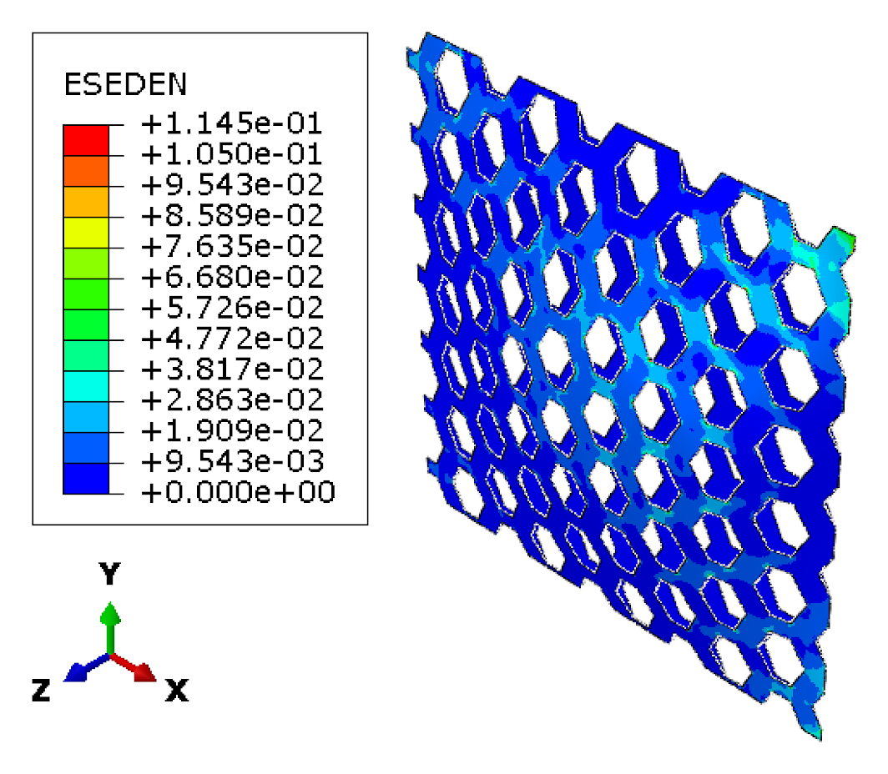
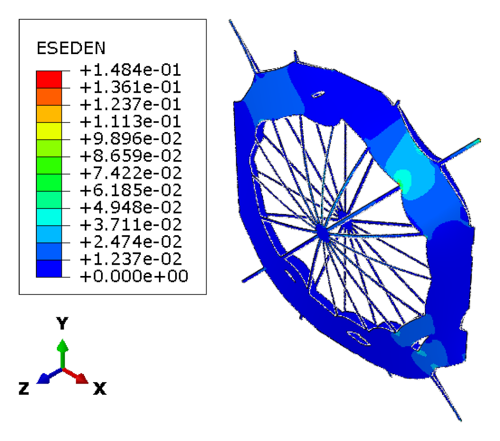
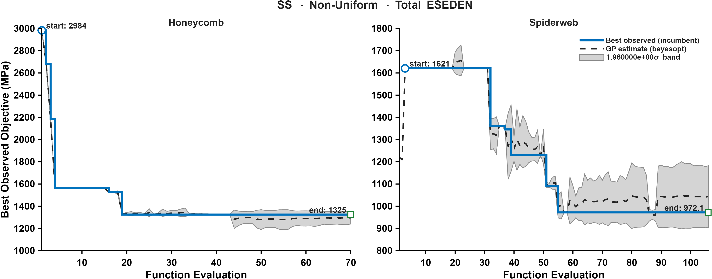
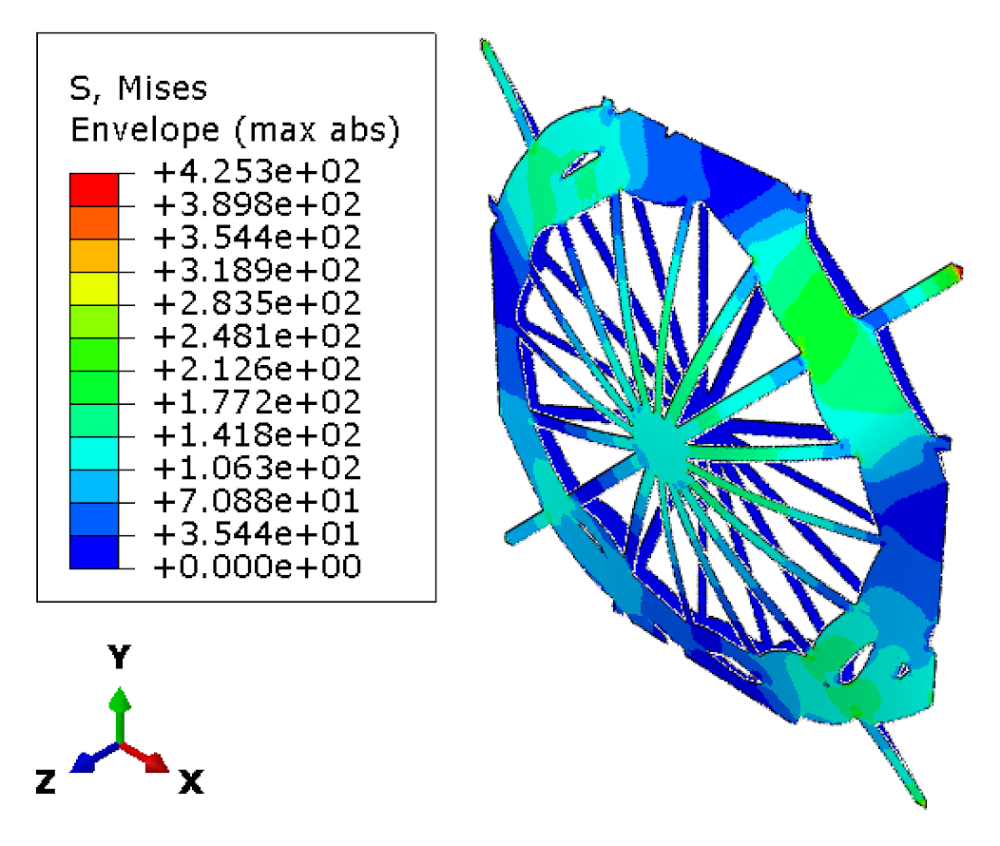
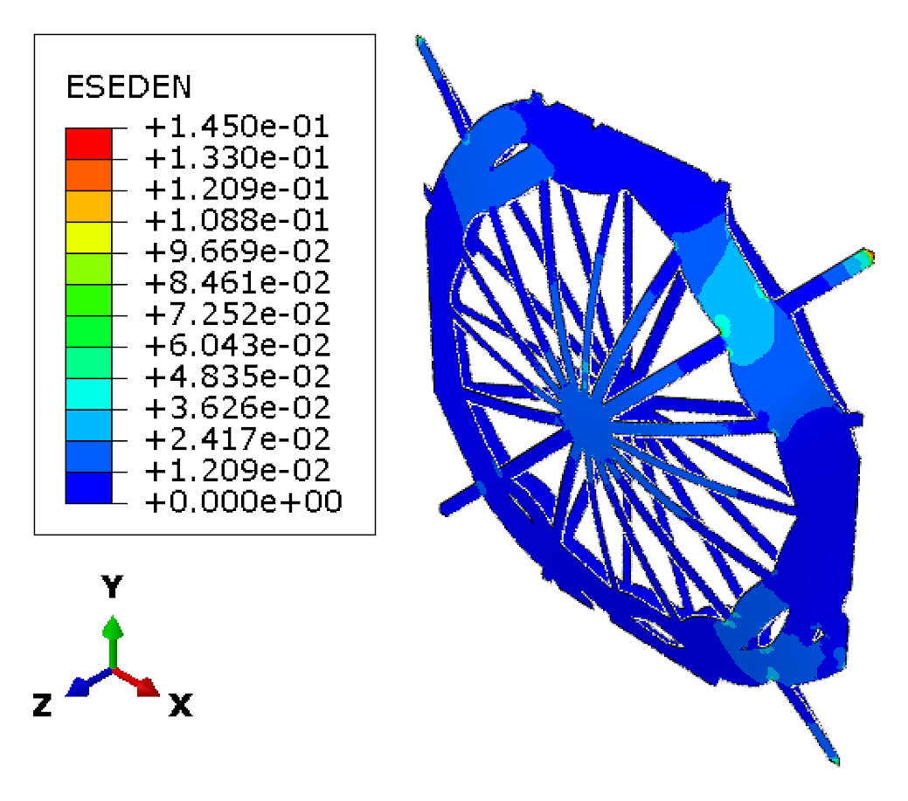
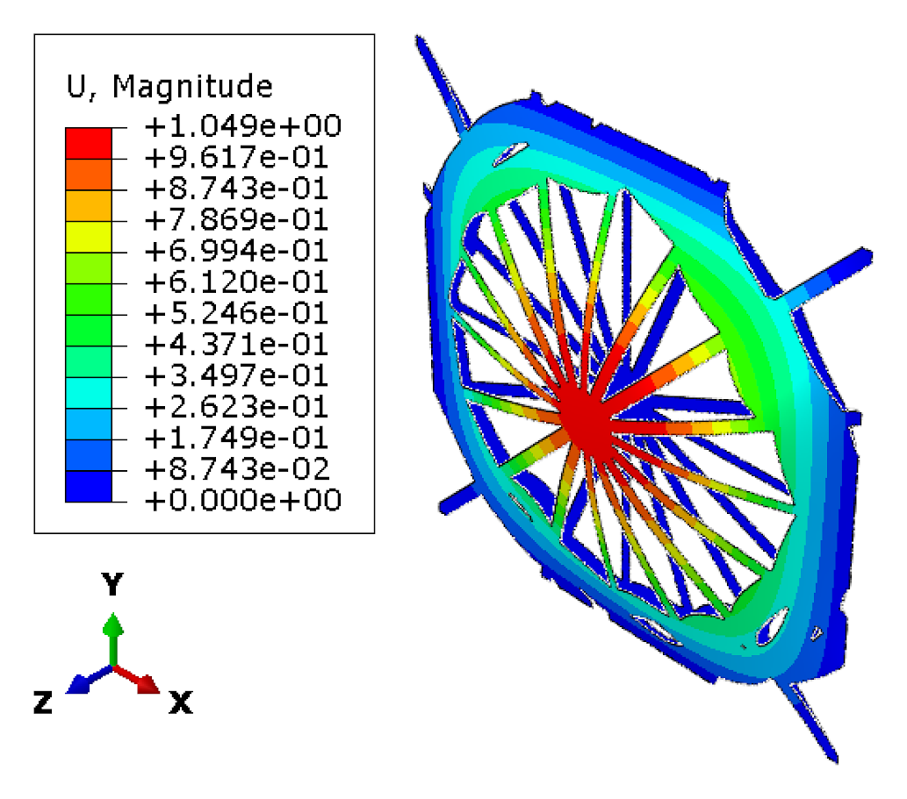
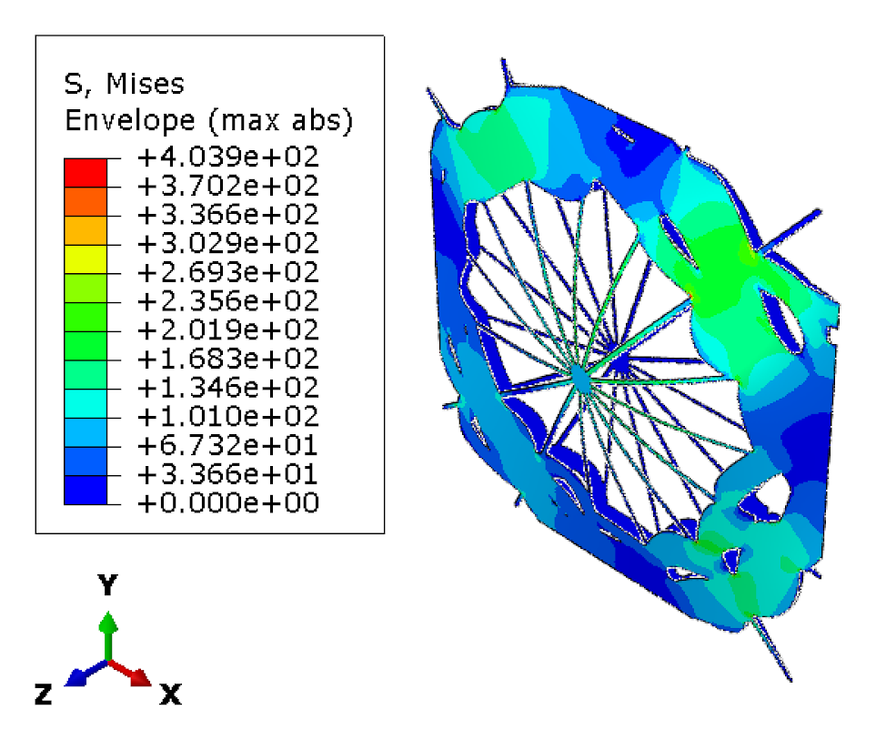
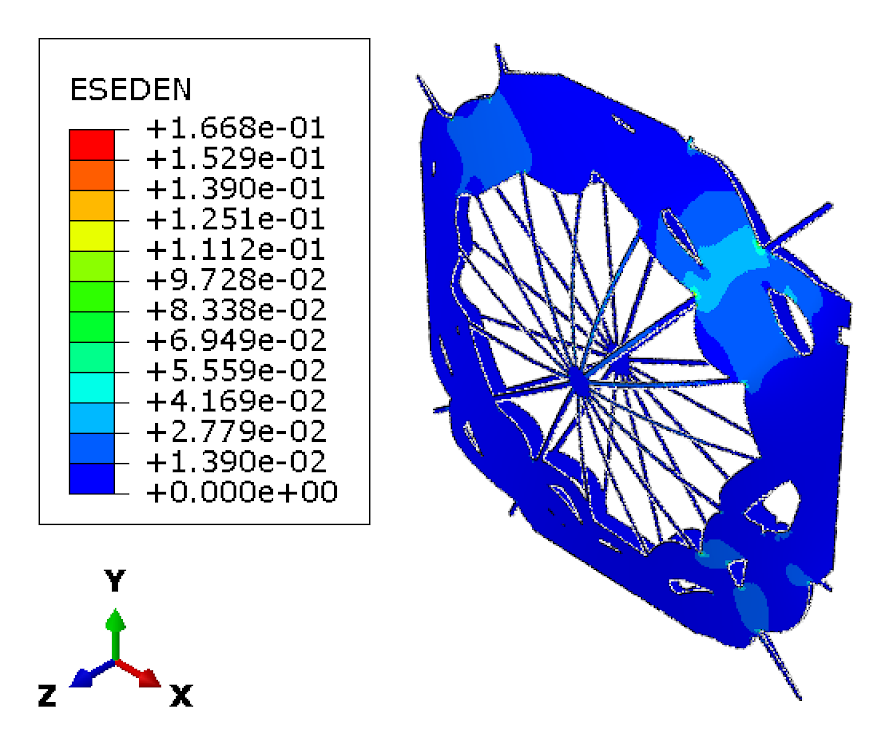
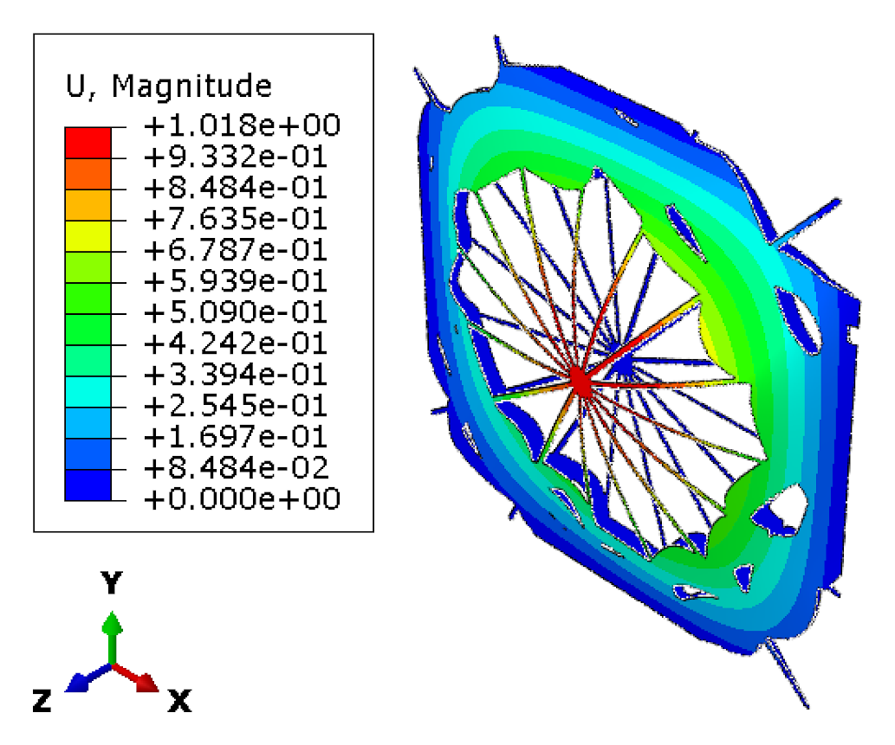

CASE 05 OF 12

# Simply Supported &middot; Non-Uniform Pressure

### Minimize total ESEDEN

[&larr; Case 04](../SS_NonUniform_VM/) &nbsp;&middot;&nbsp; [Case Index](../README.md#case-index) &nbsp;&middot;&nbsp; [Case 06 &rarr;](../SS_NonUniform_MaxESEDEN/)

 

| Boundary condition | Loading | Objective |
|:--|:--|:--|
| Simply supported, all edges | Non-uniform transverse pressure, <i>P</i>(<i>x</i>,<i>y</i>) &prop; <i>x</i>2 + <i>y</i>2 | Minimize total elastic strain energy density (ESEDEN) |

## Optimal Designs

### Honeycomb

<table>
<tr>
<td width="64%" align="center"> Elastic strain energy density, ESEDEN (MPa)</td>
<td width="36%" valign="middle">
<table>
<tr><th>Parameter</th><th>Value</th></tr>
<tr><td align="center">&alpha;</td><td align="right">1.1093</td></tr>
<tr><td align="center">&beta;</td><td align="right">0.3425</td></tr>
<tr><td align="center"><i>t</i></td><td align="right">9 mm</td></tr>
<tr><td align="center"><i>h</i></td><td align="right">37.672 mm</td></tr>
<tr><td align="center">Area fraction</td><td align="right">58.16 %</td></tr>
<tr><td align="center">Shell thickness</td><td align="right">8.35 mm</td></tr>
</table>
</td>
</tr>
</table>

### Spider Web

<table>
<tr>
<td width="64%" align="center"> Elastic strain energy density, ESEDEN (MPa)</td>
<td width="36%" valign="middle">
<table>
<tr><th>Parameter</th><th>Value</th></tr>
<tr><td align="center"><i>N</i>r</td><td align="right">16</td></tr>
<tr><td align="center"><i>N</i>s</td><td align="right">5</td></tr>
<tr><td align="center"><i>t</i>r</td><td align="right">2 mm</td></tr>
<tr><td align="center"><i>t</i>f</td><td align="right">11 mm</td></tr>
<tr><td align="center">&sigma;j</td><td align="right">0.11192</td></tr>
<tr><td align="center"><i>A</i></td><td align="right">8.6247</td></tr>
<tr><td align="center"><i>f</i></td><td align="right">45.702</td></tr>
<tr><td align="center">&phi;</td><td align="right">90.51</td></tr>
<tr><td align="center"><i>p</i></td><td align="right">0.12898</td></tr>
<tr><td align="center">Area fraction</td><td align="right">49.17 %</td></tr>
<tr><td align="center">Shell thickness</td><td align="right">7.89 mm</td></tr>
</table>
</td>
</tr>
</table>

Parameter definitions: [Design Parameterization](../README.md#design-parameterization)

## Performance Metrics

| Metric | Honeycomb | Spider Web |
|:--|--:|--:|
| Max von Mises stress (MPa) | 378.48 | 434.91 |
| **Total ESEDEN (MPa)** &nbsp;objective | 1324.85 | **1033.76** |
| Max ESEDEN (MPa) | 0.1145 | 0.1484 |
| Max displacement (mm) | 0.9988 | 1.1244 |

## Optimization Convergence

Left: honeycomb &middot; Right: spider web. Solid line: best observed incumbent objective. Dashed line: Gaussian-process posterior mean. Shaded band: 1.96&sigma; credible interval.

## Intermediate Spider Web Designs

<b>Intermediate design 1</b>

 

<table>
<tr><th width="33%">von Mises stress (MPa)</th><th width="33%">ESEDEN (MPa)</th><th width="33%">Displacement (mm)</th></tr>
<tr>
<td align="center"></td>
<td align="center"></td>
<td align="center"></td>
</tr>
</table>

<b>Intermediate design 2</b>

 

<table>
<tr><th width="33%">von Mises stress (MPa)</th><th width="33%">ESEDEN (MPa)</th><th width="33%">Displacement (mm)</th></tr>
<tr>
<td align="center"></td>
<td align="center"></td>
<td align="center"></td>
</tr>
</table>

---

[&larr; Case 04](../SS_NonUniform_VM/) &nbsp;&middot;&nbsp; [Case Index](../README.md#case-index) &nbsp;&middot;&nbsp; [Case 06 &rarr;](../SS_NonUniform_MaxESEDEN/)

