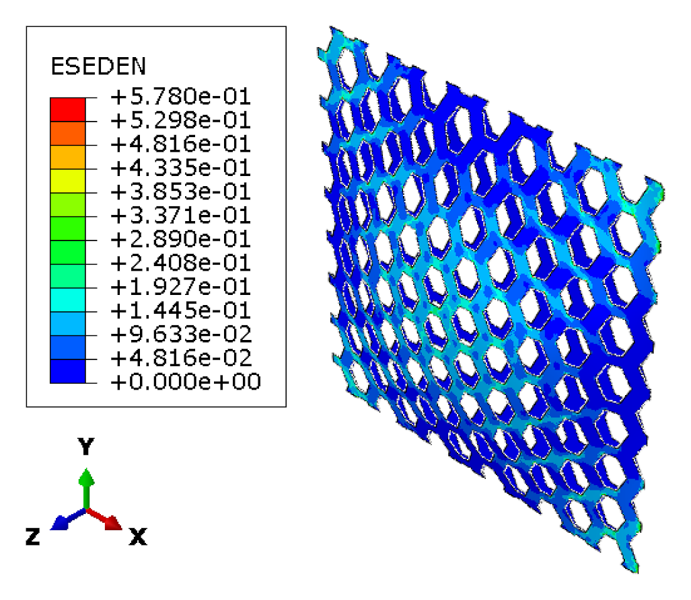
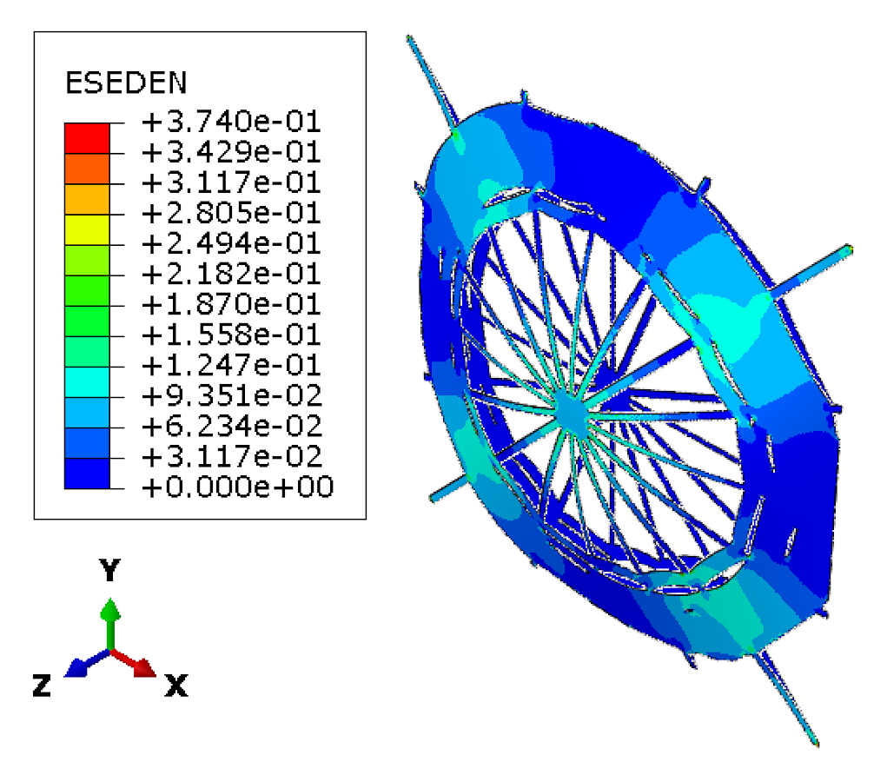
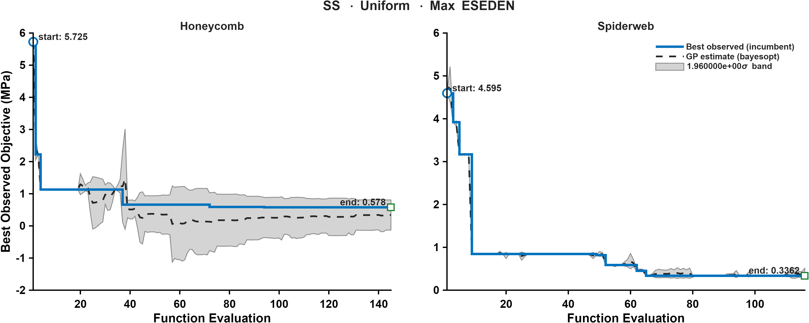
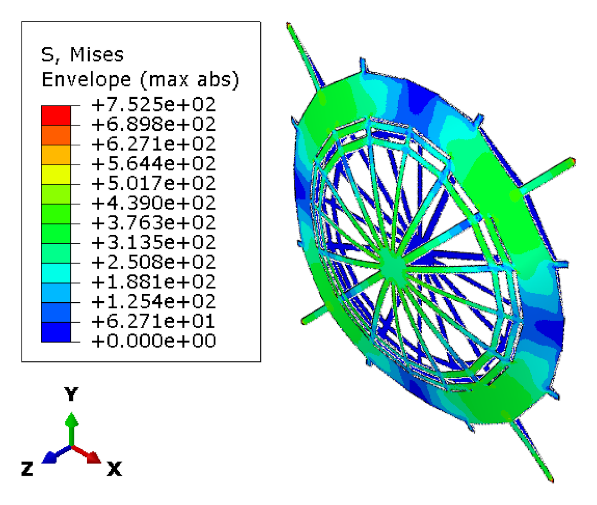
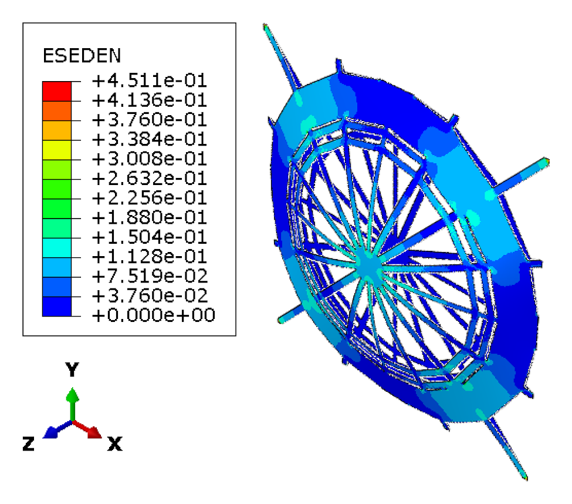
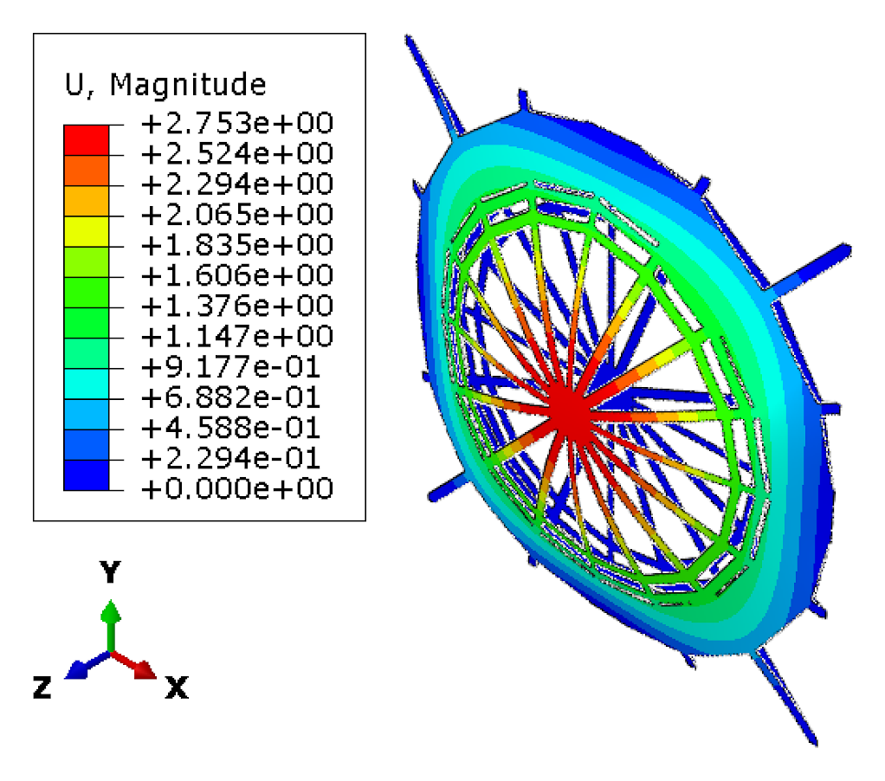

CASE 03 OF 12

# Simply Supported &middot; Uniform Pressure

### Minimize maximum ESEDEN

[&larr; Case 02](../SS_Uniform_TotalESEDEN/) &nbsp;&middot;&nbsp; [Case Index](../README.md#case-index) &nbsp;&middot;&nbsp; [Case 04 &rarr;](../SS_NonUniform_VM/)

 

| Boundary condition | Loading | Objective |
|:--|:--|:--|
| Simply supported, all edges | Uniform transverse pressure | Minimize maximum elastic strain energy density (ESEDEN) |

## Optimal Designs

### Honeycomb

<table>
<tr>
<td width="64%" align="center"> Elastic strain energy density, ESEDEN (MPa)</td>
<td width="36%" valign="middle">
<table>
<tr><th>Parameter</th><th>Value</th></tr>
<tr><td align="center">&alpha;</td><td align="right">1.1483</td></tr>
<tr><td align="center">&beta;</td><td align="right">0.25491</td></tr>
<tr><td align="center"><i>t</i></td><td align="right">7 mm</td></tr>
<tr><td align="center"><i>h</i></td><td align="right">30.162 mm</td></tr>
<tr><td align="center">Area fraction</td><td align="right">56.26 %</td></tr>
<tr><td align="center">Shell thickness</td><td align="right">8.26 mm</td></tr>
</table>
</td>
</tr>
</table>

### Spider Web

<table>
<tr>
<td width="64%" align="center"> Elastic strain energy density, ESEDEN (MPa)</td>
<td width="36%" valign="middle">
<table>
<tr><th>Parameter</th><th>Value</th></tr>
<tr><td align="center"><i>N</i>r</td><td align="right">16</td></tr>
<tr><td align="center"><i>N</i>s</td><td align="right">13</td></tr>
<tr><td align="center"><i>t</i>r</td><td align="right">3 mm</td></tr>
<tr><td align="center"><i>t</i>f</td><td align="right">6 mm</td></tr>
<tr><td align="center">&sigma;j</td><td align="right">0.043577</td></tr>
<tr><td align="center"><i>A</i></td><td align="right">5.8797</td></tr>
<tr><td align="center"><i>f</i></td><td align="right">-92.733</td></tr>
<tr><td align="center">&phi;</td><td align="right">-68.386</td></tr>
<tr><td align="center"><i>p</i></td><td align="right">0.13227</td></tr>
<tr><td align="center">Area fraction</td><td align="right">56.14 %</td></tr>
<tr><td align="center">Shell thickness</td><td align="right">8.25 mm</td></tr>
</table>
</td>
</tr>
</table>

Parameter definitions: [Design Parameterization](../README.md#design-parameterization)

## Performance Metrics

| Metric | Honeycomb | Spider Web |
|:--|--:|--:|
| Max von Mises stress (MPa) | 763.52 | 700.79 |
| Total ESEDEN (MPa) | 9653.43 | 7205.85 |
| **Max ESEDEN (MPa)** &nbsp;objective | 0.5780 | **0.3740** |
| Max displacement (mm) | 2.9314 | 2.6160 |

## Optimization Convergence

Left: honeycomb &middot; Right: spider web. Solid line: best observed incumbent objective. Dashed line: Gaussian-process posterior mean. Shaded band: 1.96&sigma; credible interval.

## Intermediate Spider Web Designs

<b>Intermediate design 1</b>

 

<table>
<tr><th width="33%">von Mises stress (MPa)</th><th width="33%">ESEDEN (MPa)</th><th width="33%">Displacement (mm)</th></tr>
<tr>
<td align="center"></td>
<td align="center"></td>
<td align="center"></td>
</tr>
</table>

---

[&larr; Case 02](../SS_Uniform_TotalESEDEN/) &nbsp;&middot;&nbsp; [Case Index](../README.md#case-index) &nbsp;&middot;&nbsp; [Case 04 &rarr;](../SS_NonUniform_VM/)

