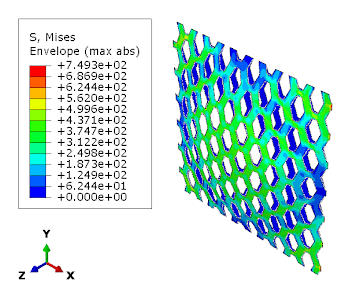
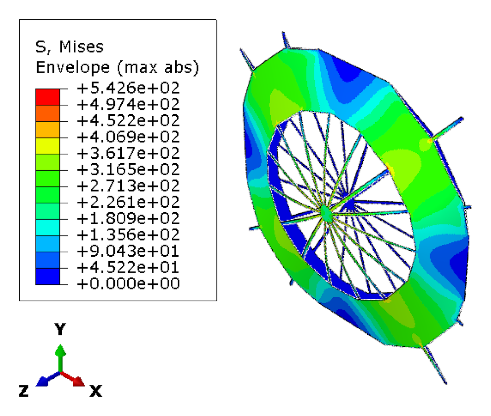
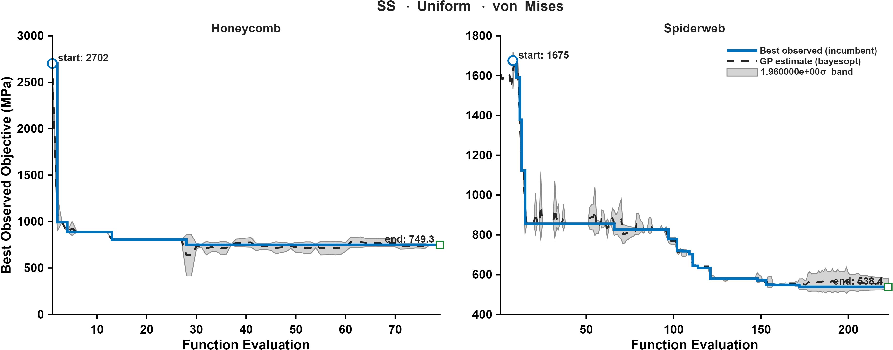
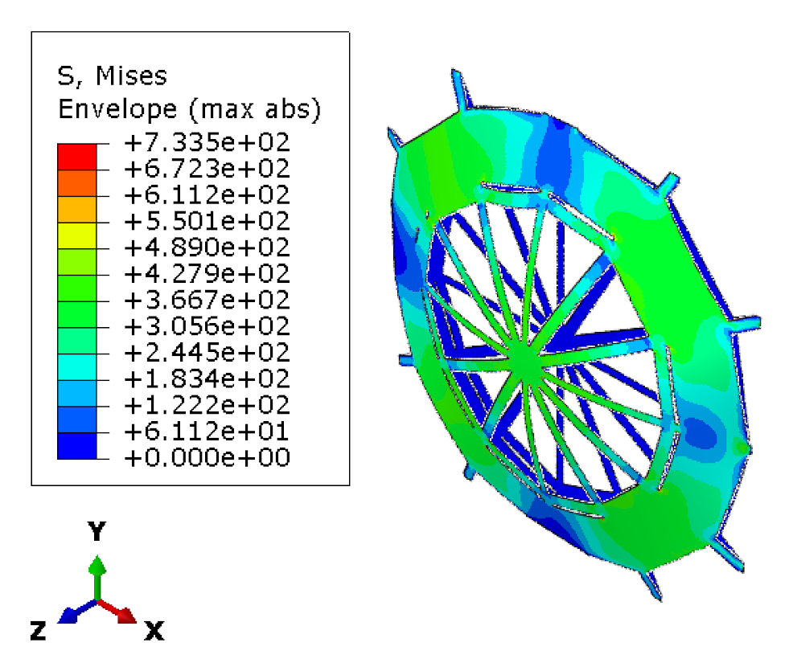
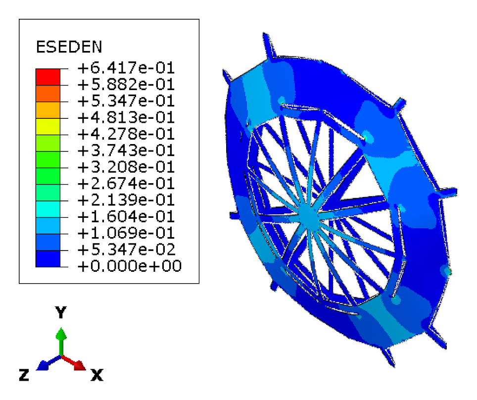
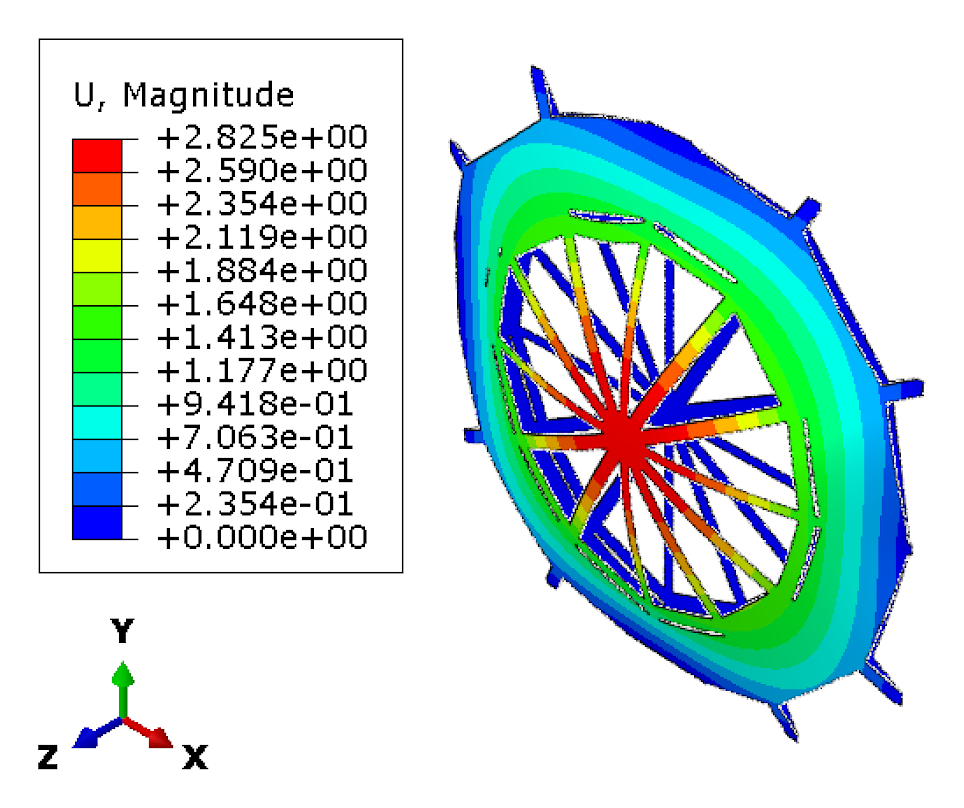
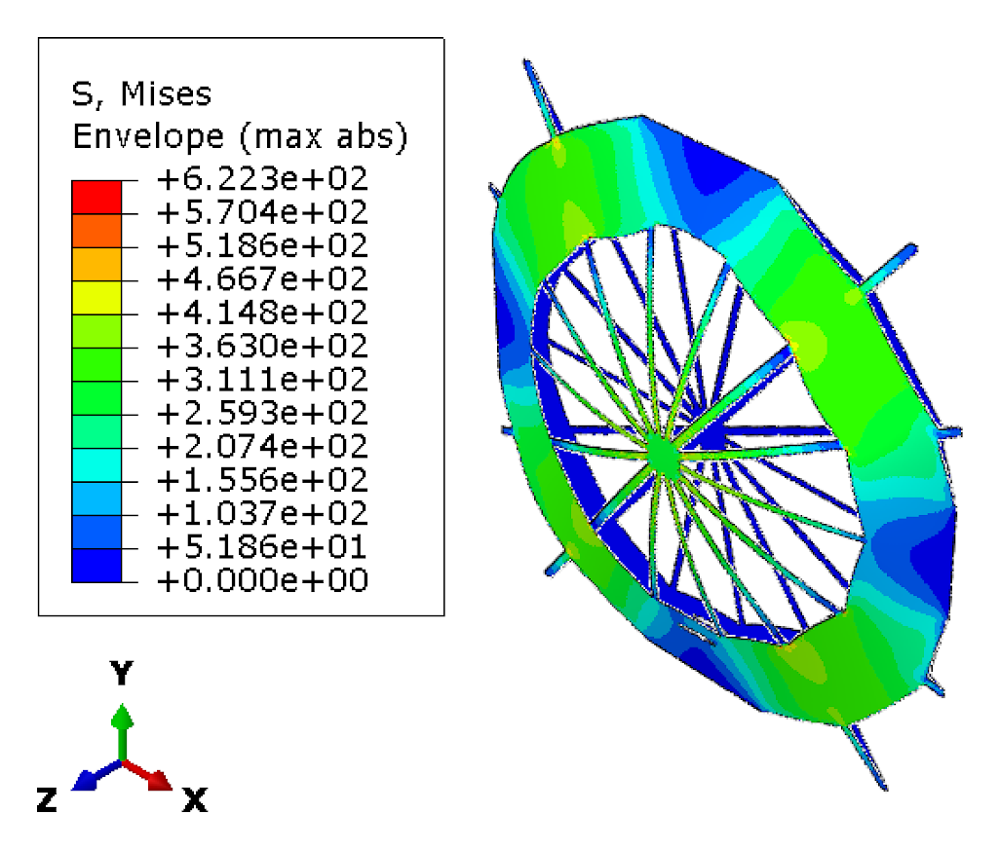
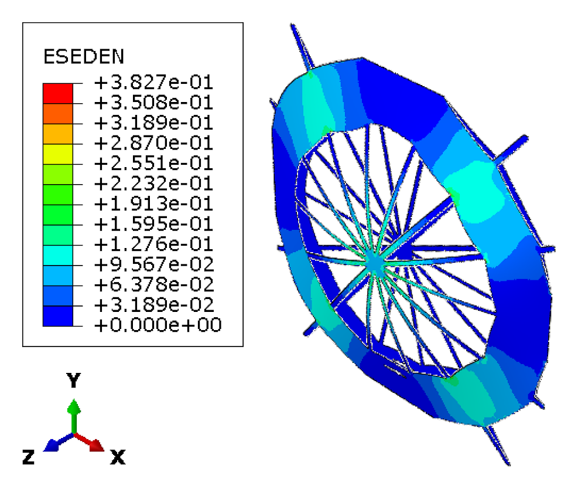
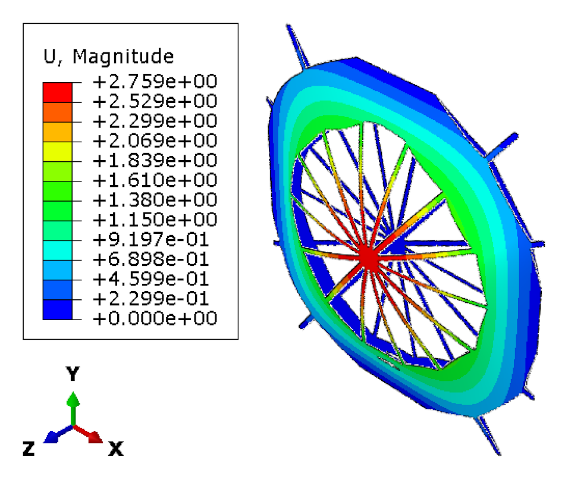

CASE 01 OF 12

# Simply Supported &middot; Uniform Pressure

### Minimize maximum von Mises stress

[&larr; Case 12](../CC_NonUniform_MaxESEDEN/) &nbsp;&middot;&nbsp; [Case Index](../README.md#case-index) &nbsp;&middot;&nbsp; [Case 02 &rarr;](../SS_Uniform_TotalESEDEN/)

 

| Boundary condition | Loading | Objective |
|:--|:--|:--|
| Simply supported, all edges | Uniform transverse pressure | Minimize maximum von Mises stress |

## Optimal Designs

### Honeycomb

<table>
<tr>
<td width="64%" align="center"> von Mises stress (MPa)</td>
<td width="36%" valign="middle">
<table>
<tr><th>Parameter</th><th>Value</th></tr>
<tr><td align="center">&alpha;</td><td align="right">1.4378</td></tr>
<tr><td align="center">&beta;</td><td align="right">0.13615</td></tr>
<tr><td align="center"><i>t</i></td><td align="right">8 mm</td></tr>
<tr><td align="center"><i>h</i></td><td align="right">30.09 mm</td></tr>
<tr><td align="center">Area fraction</td><td align="right">57.56 %</td></tr>
<tr><td align="center">Shell thickness</td><td align="right">8.32 mm</td></tr>
</table>
</td>
</tr>
</table>

### Spider Web

<table>
<tr>
<td width="64%" align="center"> von Mises stress (MPa)</td>
<td width="36%" valign="middle">
<table>
<tr><th>Parameter</th><th>Value</th></tr>
<tr><td align="center"><i>N</i>r</td><td align="right">15</td></tr>
<tr><td align="center"><i>N</i>s</td><td align="right">18</td></tr>
<tr><td align="center"><i>t</i>r</td><td align="right">2 mm</td></tr>
<tr><td align="center"><i>t</i>f</td><td align="right">10 mm</td></tr>
<tr><td align="center">&sigma;j</td><td align="right">-0.0035939</td></tr>
<tr><td align="center"><i>A</i></td><td align="right">1.6913</td></tr>
<tr><td align="center"><i>f</i></td><td align="right">90.018</td></tr>
<tr><td align="center">&phi;</td><td align="right">58.93</td></tr>
<tr><td align="center"><i>p</i></td><td align="right">0.1149</td></tr>
<tr><td align="center">Area fraction</td><td align="right">56.58 %</td></tr>
<tr><td align="center">Shell thickness</td><td align="right">8.27 mm</td></tr>
</table>
</td>
</tr>
</table>

Parameter definitions: [Design Parameterization](../README.md#design-parameterization)

## Performance Metrics

| Metric | Honeycomb | Spider Web |
|:--|--:|--:|
| **Max von Mises stress (MPa)** &nbsp;objective | 749.34 | **542.58** |
| Total ESEDEN (MPa) | 9710.77 | 6263.92 |
| Max ESEDEN (MPa) | 0.5390 | 0.2459 |
| Max displacement (mm) | 2.8439 | 2.4717 |

## Optimization Convergence

Left: honeycomb &middot; Right: spider web. Solid line: best observed incumbent objective. Dashed line: Gaussian-process posterior mean. Shaded band: 1.96&sigma; credible interval.

## Intermediate Spider Web Designs

<b>Intermediate design 1 &nbsp;·&nbsp; iteration 102</b>

 

<table>
<tr><th width="33%">von Mises stress (MPa)</th><th width="33%">ESEDEN (MPa)</th><th width="33%">Displacement (mm)</th></tr>
<tr>
<td align="center"></td>
<td align="center"></td>
<td align="center"></td>
</tr>
</table>

<b>Intermediate design 2 &nbsp;·&nbsp; iteration 114</b>

 

<table>
<tr><th width="33%">von Mises stress (MPa)</th><th width="33%">ESEDEN (MPa)</th><th width="33%">Displacement (mm)</th></tr>
<tr>
<td align="center"></td>
<td align="center"></td>
<td align="center"></td>
</tr>
</table>

---

[&larr; Case 12](../CC_NonUniform_MaxESEDEN/) &nbsp;&middot;&nbsp; [Case Index](../README.md#case-index) &nbsp;&middot;&nbsp; [Case 02 &rarr;](../SS_Uniform_TotalESEDEN/)

